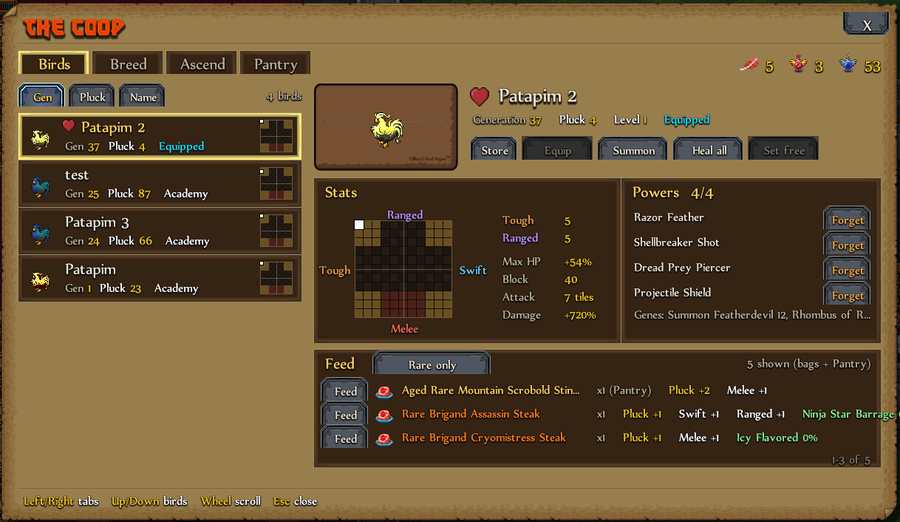

# The Coop

The Coop shows every Battle Poultry bird you own in one window, with everything you can do with them. Open it with the **bird button** in the top bar, **Coop** on the bird window, or "Open the Coop" in Professor Hatch's menu.

## Birds tab

- The list shows your birds, best first (sort by generation, Pluck or name). Click one to see its stat map, powers and genes.
- **Store / Take**, **Equip**, **Summon** (no whistle needed), **Heal all** and **Set free** (click twice).
- The **heart** marks your favorite bird. It is listed first, and the QoL mod's Prepare hero equips it.
- **Forget** removes a power for one Power Pruning Poultice.
- **Feed:** rare steaks and Plumage from your bags (and the Pantry), each with its effect and its chance to teach a power.

Away from the Academy, the Coop only works with the birds and items in your bags.
