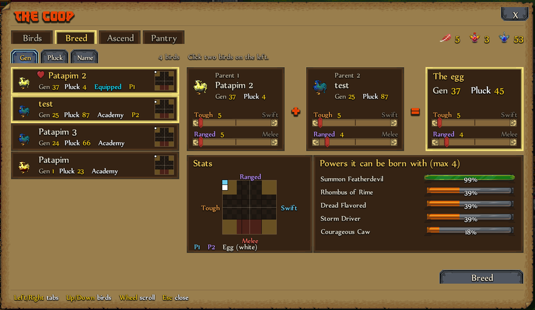
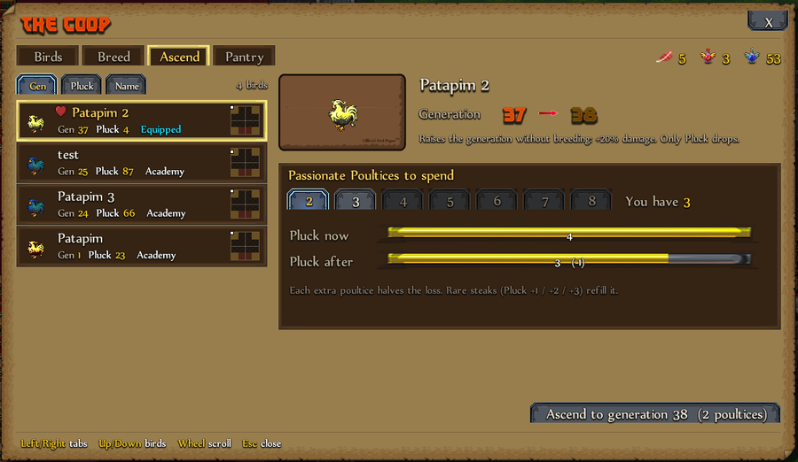

# Breed and Ascend

## Breed

Pick two parents on the left. Before you spend anything, the Coop shows the egg's exact generation, Pluck and stats, and the chance of each power (hover a power for its gene count). Both parents are kept.

Breeding costs a Passionate Poultry Poultice. Same-generation parents give an egg one generation higher.

**Bug fix:** in the base game, breeding overwrites the first parent's genes with the egg's. With the fix (on by default, in Mod Settings), both parents keep their genes.

## Ascend

Ascend raises a bird's generation without breeding: +20% damage per generation. It costs 2 to 8 Passionate Poultices, and the bird keeps its stats, powers and genes. Its Pluck drops: Pluck after = Pluck - (Pluck x 0.5^N).

