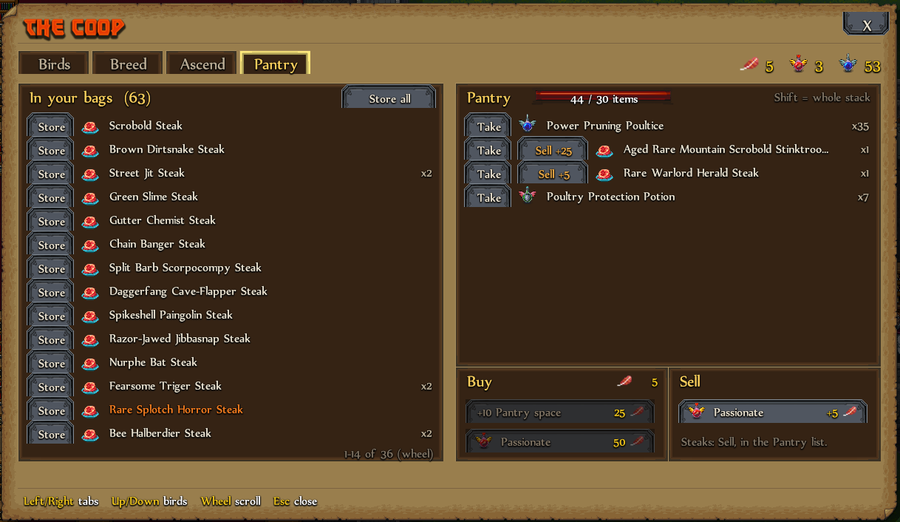

# The Pantry

The Pantry is storage at the Academy for steaks, Plumage of Power, poultices, rename cards and protection potions. It is kept in your save, so it survives your heroes.

- **Store all** and **Take** (`Shift` = the whole stack). It holds 30 items to start.
- **Sell steaks** for Feathers: 1 / 5 / 25 / 125 depending on rarity.
- **Feathers** also come from setting birds free and selling Passionate Poultices. Spend them on more Pantry space or a Passionate Poultice.

## Leaderboards

The Pantry is a setting (on by default). **While it is on, no score is sent to the Steam leaderboards**, since stored poultices and steaks are an edge. Switching it off hides the Pantry tab; what you stored stays and comes back when you switch it on again.
