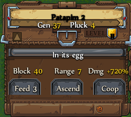

# The bird window

While a bird is equipped, a small window sits above your hero's vitals.

- Name, level, generation and Pluck, then health (or "Wounded" / "In its egg").
- Block or Parry, Range and Damage: hover each for details.
- **Feed**, **Ascend** and **Coop** open the Coop on this bird.
- Drag it by its name plate; the arrow folds it.

## Professor Hatch

Bumping into Hatch opens his work menu directly, his Ovomansy FAQ is an entry in that menu, and the deposit and withdraw lists have **Deposit all** / **Withdraw all**.
